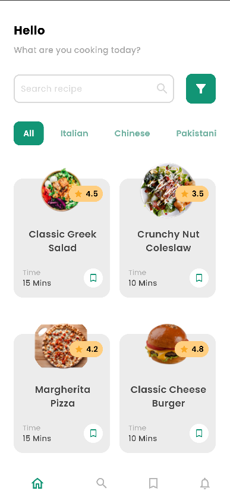
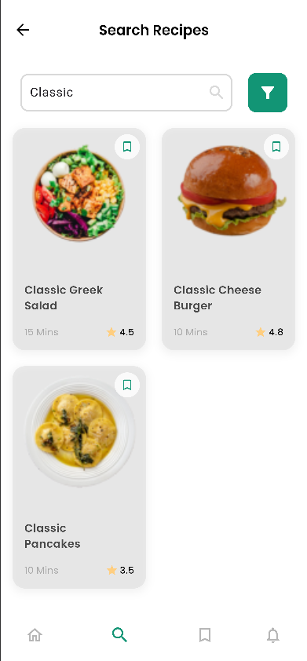
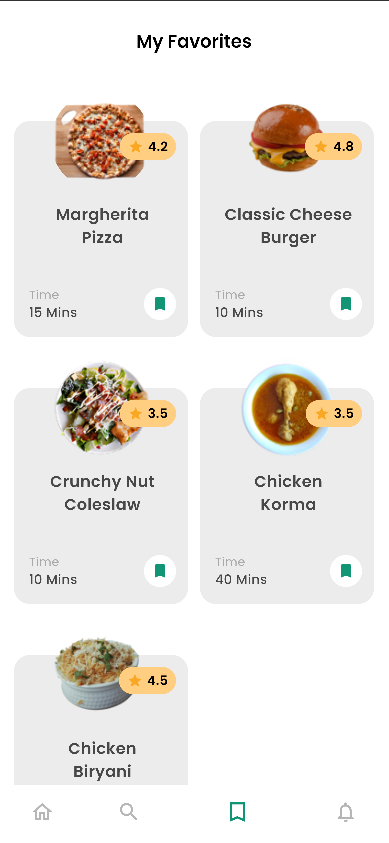
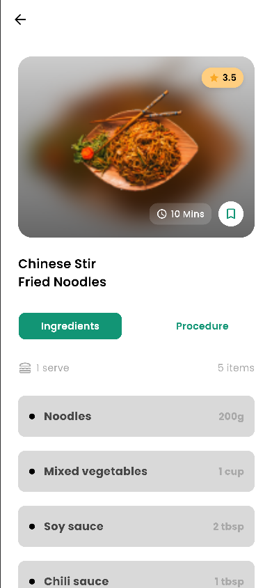
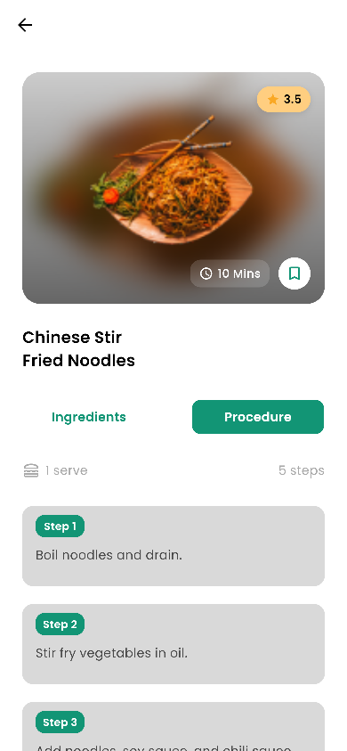

# Cookify

Cookify is a Flutter recipe browsing app with a clean, mobile-first interface for
discovering recipes, viewing cooking instructions, and saving favorites.

The current version is a local demo: recipe content is defined in Dart source
files and favorites are kept in memory while the app is running. No account,
remote API, or persistent database is required.

## Features

- Splash screen with Cookify branding and automatic navigation to the app.
- Home screen with a recipe search entry point, category tabs, and a
  horizontally scrolling “New Recipes” section.
- Recipe catalogue with 20 sample recipes across Italian, Chinese, Pakistani,
  and Asian categories.
- Search recipes by title with empty-state and no-results messages.
- Recipe details with image, rating, cooking time, ingredients, and numbered
  procedure steps.
- Toggle between ingredients and cooking procedure on the detail screen.
- Add or remove recipes from favorites using Provider state management.
- Favorites screen with an empty state and a grid of saved recipes.
- Bottom navigation for Home, Search, Favorites, and Notifications.
- Local image assets and Google Fonts-based styling.

## Screenshots

| Splash | Home |
| --- | --- |
|  |  |

| Search | Favorites |
| --- | --- |
|  |  |

| Ingredients | Procedure |
| --- | --- |
|  |  |

## Tech stack

- **Flutter** and **Dart**
- **Provider** for favorites state management
- **Google Fonts** for typography
- **Material widgets** and responsive layouts

## Requirements

- Flutter SDK with Dart 3.8.1 or newer
- A configured Flutter target such as Android, iOS, web, Windows, macOS, or
  Linux

Check the installed toolchain with:

```bash
flutter doctor
```

## Getting started

1. Clone or download the project.
2. Open a terminal in the project directory.
3. Install dependencies:

   ```bash
   flutter pub get
   ```

4. List available devices:

   ```bash
   flutter devices
   ```

5. Run the application:

   ```bash
   flutter run
   ```

## Useful commands

```bash
# Analyze Dart code
flutter analyze

# Run tests
flutter test

# Format Dart files
dart format lib test

# Build an Android APK
flutter build apk
```

## Project structure

```text
lib/
├── main.dart                     # App entry point and Provider setup
├── data/                         # Local sample recipe data
├── model/                        # Recipe and new-recipe models
├── provider/                     # Favorites state
├── screens/                      # Splash, home, search, favorites, and detail screens
└── widgets/                      # Navigation, cards, sections, and shared UI
assets/
├── images/                       # Recipe and splash images
└── *.png                         # App icon and documentation screenshots
```

## Data and current scope

- The main catalogue contains 20 local `Recipe` entries, and the home screen
  contains three `NewRecipe` entries.
- Favorites are session-only and are not restored after the app is closed.
- Notifications currently show an empty-state screen.
- The category filter tabs on the home screen filter the bundled recipe list.
- The search screen currently matches recipe titles.
- There is no backend, authentication, remote synchronization, or persistent
  storage in this version.

## License

No license has been specified for this project yet.
